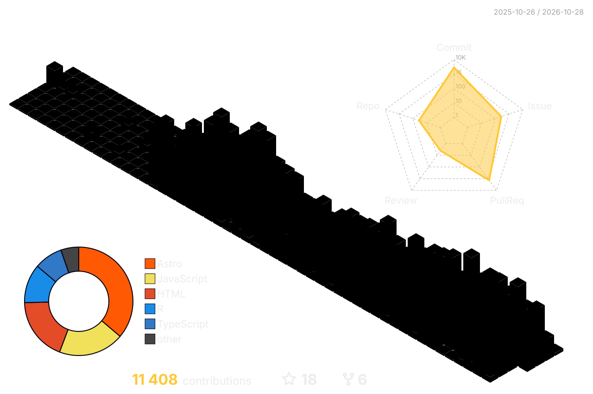

&nbsp;&nbsp;&nbsp;&nbsp;&nbsp;&nbsp;&nbsp;

---

<h3>&nbsp;&nbsp;About</h3>

<table>
<tr><td><b>Role</b></td><td>GIS analyst &amp; data scientist</td></tr>
<tr><td><b>Focus</b></td><td>Remote sensing &middot; Conservation science &middot; Spatial storytelling</td></tr>
</table>

GIS analyst and data scientist at the intersection of **remote sensing**, **conservation science**, and **spatial storytelling**. I build tools, maps, and models that help people understand how landscapes change, and what those changes mean.

> **Understanding patterns through time gives people the power to see beyond the moment and shape a more intentional world.**

---

<h3>&nbsp;&nbsp;Active research</h3>

<table>
<tr>
<td valign="top" width="50%">

<h4>&nbsp;&nbsp;Wildfire &amp; conservation</h4>

- Role of Conservation Reserve Program lands in wildfire
- Large wildfire regime analysis
- Wildfire damage assessment for structures

</td>
<td valign="top" width="50%">

<h4>&nbsp;&nbsp;Geospatial tools &amp; data</h4>

- Curating US Census TIGER Roads in GEE
- Building geospatial products for decision-making
- Designing public-facing tools for the public

</td>
</tr>
</table>

---

<h3>&nbsp;&nbsp;Stack</h3>

**Languages**

**GIS &amp; remote sensing**

**Data &amp; dev**

---

<h3>&nbsp;&nbsp;Contributions</h3>

  

  
  

---

<h3>&nbsp;&nbsp;Let's work together</h3>

I collaborate on projects that build **resilient landscapes and communities** through tools, research partnerships, and data pipelines.

&nbsp;
&nbsp;

